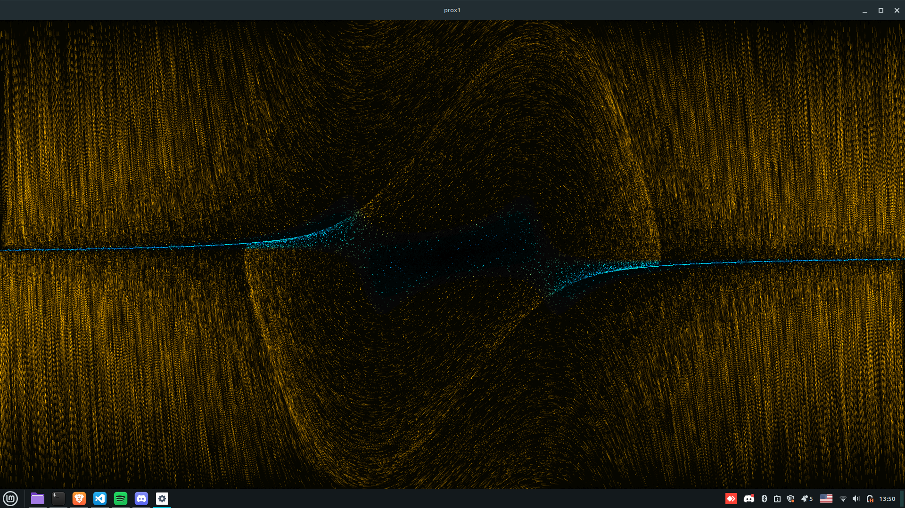
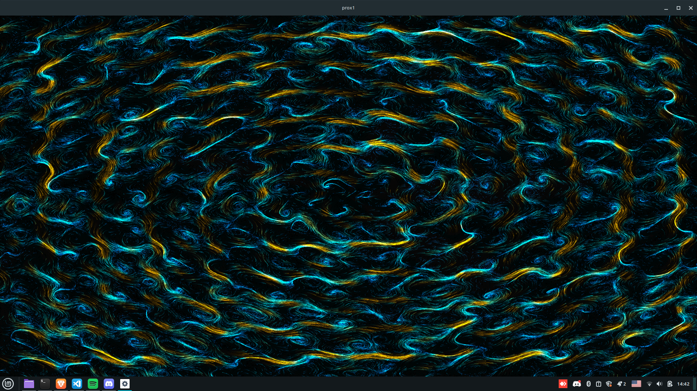
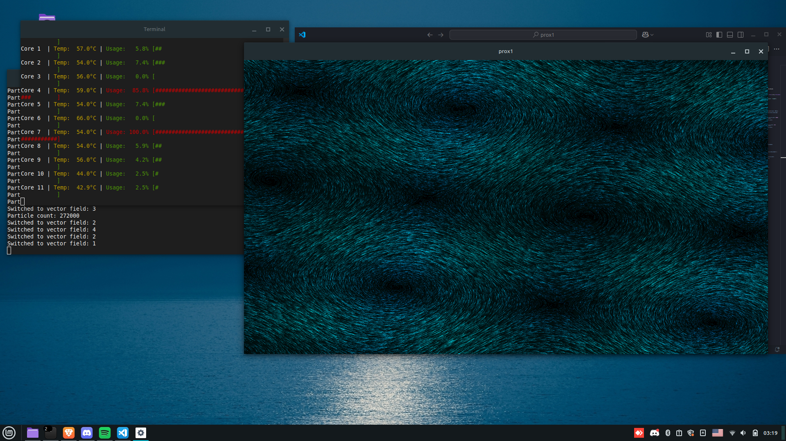

# prox1
Vector fields implemented in C with OpenGL and RGFW

## Structure
All configuration lays in config.ini. It is only read at startup; the program never writes it.

Build with `make`, run `make test` for the unit tests. Run `./prox1` from the repo root (it loads `config.ini` and `shaders/` relative to the current folder).

Trails rely on the window's back buffer keeping its contents after a swap. This holds on X11/GLX; on other setups the trails may flicker.

## Data flow
```txt
User Input → Camera → Particles → Vector Field → Integration → Renderer
     ↓                    ↑             ↓
   Config  ←──────────────┴─────────────┘
```

## To fix / implement (Issues)
- New input system for more fields support

## Showcase


